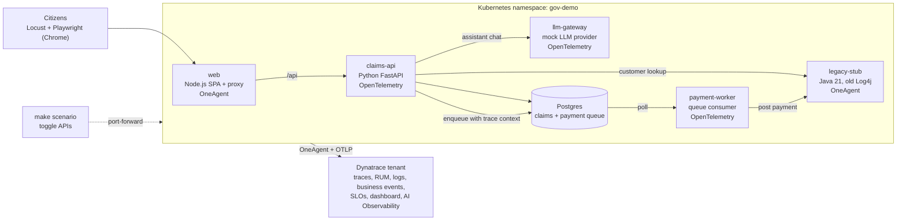

# Carer Support Portal (Dynatrace demo)

A fictional "Department of Community Services" portal for Dynatrace demos. Citizens sign in, claim carer support, upload a document, get an eligibility decision, are paid through a queue, and can ask an AI assistant questions. Every part of that journey is instrumented, and every failure mode can be switched on with one command.

> Lab use only. All policy, amounts and citizens are invented and synthetic. The legacy tier deliberately carries a vulnerable library, so never expose it to the internet.

## What the demo shows

| Capability | What you see in Dynatrace |
|---|---|
| Distributed tracing across technologies | One claim is one trace: browser, Node.js, Python, Postgres, a queue handover and a Java legacy tier. OneAgent and OpenTelemetry spans join into a single trace |
| Real user monitoring | Journey funnel, completion and abandonment, furthest step reached, web vitals (LCP, CLS, TTFB), driven by real Chrome sessions |
| AI Observability | A mock LLM gateway with prompts, token and cost metrics, guardrail outcomes, groundedness, provider errors and latency |
| Business events | Draft, eligibility, document, submitted and payment posted, with amounts and queue wait, shaped by OpenPipeline |
| Problem detection and root cause | Bad release, legacy saturation and provider outage produce real problems with a cause to find |
| Deployment events | The "bad release" scenario logs a deployment event, so the slowdown can be tied to a change |
| SLOs | Seven SLOs that show scenario damage as error budget burn |
| Security | A deliberately old Log4j in the legacy stub for runtime vulnerability detection |
| Data privacy | TFN and Medicare numbers leaking into prompts and logs, and masking with OpenPipeline |
| Dashboard | One dashboard, "Carer Support Portal demo", tells the whole story |

## Scenarios

Scenarios are applied with `make scenario NAME=<name>` from `gov-demo/`.

| Scenario | Story |
|---|---|
| `baseline` | Steady load, one claim as one trace |
| `bad_release` | New eligibility release is slower and fails for ages 45 to 54 |
| `monday_peak` | Load ramps, the legacy tier saturates, the queue grows and payments fail |
| `upload_dropoff` | Citizens abandon at the upload step |
| `ai_injection` | Prompt injection leaks another citizen's synthetic claim |
| `ai_pii` | Personal identifiers in prompts and logs |
| `ai_cost_spike` | Verbose answers, token and cost jump |
| `ai_hallucination` | Wrong amount and an invented policy clause |
| `provider_outage` | The LLM provider returns 503s |

## Architecture



Five services, one database and a load generator, running on Kubernetes with the Dynatrace Operator. The full diagram, with per-service ports and the instrumentation split, is in [gov-demo/README.md](gov-demo/README.md#architecture).

## Prerequisites

- Docker, `make`, `python3` and `kubectl` pointed at a cluster (Rancher Desktop, Docker Desktop, OrbStack, Colima, or any cluster plus a registry)
- Dynatrace tenant with the Dynatrace Operator and a DynaKube (`applicationMonitoring` and OTLP `telemetryIngest`). Without it the app runs but sends nothing to Dynatrace
- `dtctl` to apply SLOs, the dashboard and OpenPipeline config
- Node.js and Google Chrome for browser load

Details are in [gov-demo/README.md](gov-demo/README.md#prerequisites).

## Get started

```bash
cd gov-demo
make deploy                      # build, deploy, wait
make scenario NAME=baseline      # start steady load
make browser-load PROFILE=completer SESSIONS=6
```

## Where to go next

- Start here: [gov-demo/README.md](gov-demo/README.md) (architecture, run it, deploy it, scenarios, browser load, disk)
- Demo script and what to show in Dynatrace: [gov-demo/docs/runbook.md](gov-demo/docs/runbook.md)
- Deploy to your cluster: [gov-demo/docs/deploy.md](gov-demo/docs/deploy.md)
- Tenant configuration (OpenPipeline, SLOs, dashboard, masking): [gov-demo/docs/dynatrace-config.md](gov-demo/docs/dynatrace-config.md)
- Build specification: [gov-demo-spec.md](gov-demo-spec.md), progress and decision log: [PROGRESS.md](PROGRESS.md)
