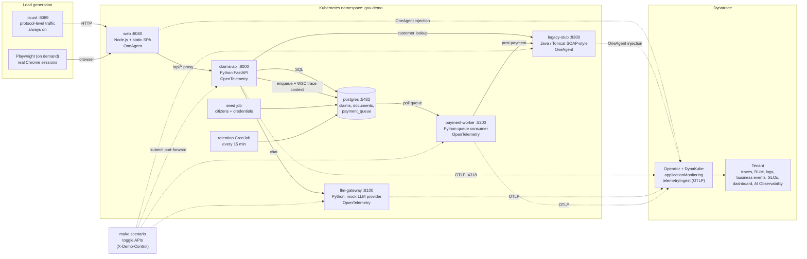

# Government Demo App (Carer Support Portal)

A fictional "Department of Community Services" portal built to show Dynatrace observability end to end: distributed tracing across mixed technologies, real user monitoring, business events, AI observability, SLOs and runtime vulnerability detection. Every scenario can be switched on and off with one command.

> **Lab use only.** All policy, thresholds, amounts and citizen data are invented and synthetic. The legacy stub deliberately carries a vulnerable Log4j, so never expose this stack to the internet.

## Contents

- [Architecture](#architecture)
- [Services](#services)
- [Prerequisites](#prerequisites)
- [Quick start](#quick-start)
- [Deploy to Kubernetes](#deploy-to-kubernetes)
- [Configure Dynatrace](#configure-dynatrace)
- [Generate load](#generate-load)
- [Scenarios](#scenarios)
- [Configuration](#configuration)
- [Disk and data retention](#disk-and-data-retention)
- [Repository layout](#repository-layout)
- [Further reading](#further-reading)

## Architecture



### How a claim flows

1. The browser (or Locust) talks only to `web`, which serves the single-page app and proxies `/api/*` to `claims-api`.
2. `claims-api` owns the claim lifecycle: draft, eligibility, document upload, submit. It looks up the citizen in the **legacy stub** (a SOAP-style call to the Java tier) and stores state in Postgres.
3. On submit, `claims-api` writes a row to `payment_queue` that carries the W3C trace context. `payment-worker` polls the queue, calls the legacy stub to post the payment, and continues the **same trace**.
4. The assistant chat goes `claims-api` to `llm-gateway`, which is a mock provider with canned responses, guardrails and simulated latency, errors and token counts. No real model is called.
5. Business events (draft, eligibility, document, submitted, payment posted) are emitted along the way and shaped by OpenPipeline.

### Two instrumentation paths, one trace

| Service | Runtime | Instrumentation |
|---|---|---|
| `web` | Node.js | OneAgent (injected by the Dynatrace Operator) |
| `legacy-stub` | Java 21, Tomcat | OneAgent (injected by the Dynatrace Operator) |
| `claims-api`, `llm-gateway`, `payment-worker` | Python | OpenTelemetry SDK, exported over OTLP/HTTP to the in-cluster `telemetry-ingest` service |

The agent-based and OpenTelemetry spans join into a single end-to-end trace.

## Services

| Service | Port | Role | Details |
|---|---|---|---|
| `web` | 8080 | Static SPA, `/api/*` proxy, RUM entry point | [services/web](services/web/README.md) |
| `claims-api` | 8000 | Claims, eligibility, uploads, assistant | [services/claims-api](services/claims-api/README.md) |
| `llm-gateway` | 8100 | Mock LLM provider with guardrails | [services/llm-gateway](services/llm-gateway/README.md) |
| `payment-worker` | 8200 | Queue consumer that posts payments | [services/payment-worker](services/payment-worker/README.md) |
| `legacy-stub` | 8300 (health and toggles on 8301) | Java tier with a deliberately old Log4j | [services/legacy-stub](services/legacy-stub/README.md) |
| `postgres` | 5432 | System of record and payment queue | `db/schema.sql` |
| `locust` | 8089 | Constant background load | [load/locust](load/locust/README.md) |

Every service exposes `GET /healthz`, logs structured JSON to stdout, and has a toggle API for the scenarios.

## Prerequisites

| Need | Used for | Notes |
|---|---|---|
| Docker | Building images, Compose stack | `docker buildx` is also needed when deploying through a registry |
| `make` | All commands below | Preinstalled on macOS and most Linux |
| `python3` | Seed credentials, scenario runner | The runner creates its own venv in `scenarios/.venv` |
| `kubectl` with a context for the target cluster | Kubernetes deploy, scenarios | Check with `kubectl config current-context` before every command |
| A local cluster (Rancher Desktop, Docker Desktop, OrbStack, Colima) **or** a registry you can push to | Kubernetes deploy | Local clusters use your own images, others need `REGISTRY=` |
| Dynatrace tenant, Dynatrace Operator and a DynaKube | Getting any data into Dynatrace | Optional to run the app, required for the observability story |
| [`dtctl`](docs/dynatrace-config.md) | Applying SLOs, dashboard and OpenPipeline config | Run one call at a time |
| Node.js and Google Chrome | `make browser-load` | Playwright drives the installed Chrome |

The DynaKube needs `applicationMonitoring` (OneAgent injection) and `telemetryIngest` with OTLP. On nodes without glibc (Rancher Desktop is Alpine) use `applicationMonitoring`. No API token is needed by the app itself.

## Quick start

There are two ways to run the stack. Pick one, both use port 8080 on your machine.

| | Docker Compose (`make up`) | Kubernetes (`make deploy`) |
|---|---|---|
| Purpose | Quick local look at the app | The real demo |
| Sends data to Dynatrace | **No**, no OneAgent and no telemetry export | Yes, with the Operator and a DynaKube |
| Scenarios | `make scenario TARGET=compose` | `make scenario` |

### Docker Compose (local only)

```bash
cp .env.example .env     # then change the passwords
make up                  # build and start everything, waits for healthy
make ps
make logs
make down
```

### Kubernetes (the demo)

```bash
make deploy DRYRUN=yes   # optional: preflight and plan, changes nothing
make deploy              # confirms the context, builds, applies, waits
make status

kubectl port-forward -n gov-demo svc/web 8080:8080      # http://localhost:8080
kubectl port-forward -n gov-demo svc/locust 8089:8089   # http://localhost:8089
```

Sign in with any pair from `db/out/credentials.csv` (citizen id, passcode). Avoid ids divisible by 20: they are non-residents and always ineligible. Then start steady load with `make scenario NAME=baseline`.

## Deploy to Kubernetes

`make deploy` runs preflight, creates `.env` and credentials if missing, builds the images, creates the namespace and Secrets, applies `k8s/`, and waits for the seed job and every deployment. It is safe to re-run.

```bash
make deploy                                        # local cluster, uses your own Docker images
make deploy REGISTRY=ghcr.io/you/gov-demo TAG=v1   # any other cluster, builds amd64 + arm64 and pushes
make undeploy                                      # deletes the namespace (not the Dynatrace config)
```

To pick up a code change: `make images`, then `kubectl rollout restart -n gov-demo deploy/<service>`. Full details and troubleshooting are in [docs/deploy.md](docs/deploy.md).

## Configure Dynatrace

Per tenant, after the cluster is running. These change tenant settings, so read the files first and apply them one at a time.

1. **OpenPipeline** for business events, deployment events and masking: `docs/openpipeline/*.yaml`.
2. **SLOs** (seven of them): `dtctl create slo -f docs/slos/<name>.yaml`.
3. **Dashboard** "Carer Support Portal demo": `python3 docs/dashboards/build_dashboard.py --check`, then `dtctl apply -f docs/dashboards/gov-demo.json`.
4. **Security**: runtime vulnerability detection and the third-party vulnerability rule in `docs/security/`.

For a different tenant, the dashboard generator and OpenPipeline files contain tenant-specific ids (service entity ids, the RUM application id, dashboard and pipeline ids). Look yours up with DQL and update `build_dashboard.py` before applying. See [docs/dynatrace-config.md](docs/dynatrace-config.md).

## Generate load

**Locust** is protocol level and always on. It drives the services but has no browser, so the web tiles stay empty without the next step.

**Playwright** runs real Chrome sessions for RUM: funnel, completion and abandonment, web vitals.

```bash
make browser-load PROFILE=completer SESSIONS=8   # full journey to a paid claim
make browser-load PROFILE=abandoner SESSIONS=6   # leaves at the upload step
make browser-load PROFILE=assistant SESSIONS=3   # opens the chat and clicks two prompts
```

The portal must be reachable on `localhost:8080` (or pass `BASE_URL=`). Wait 3 to 4 minutes, then open the dashboard with the last 30 minutes selected. Completion and abandonment need both completers and abandoners. More options are in [load/browser/README.md](load/browser/README.md).

## Scenarios

Scenarios flip toggles on the services to create realistic, Dynatrace-detectable problems.

```bash
make scenario                    # list scenarios
make scenario NAME=monday_peak   # apply one (resets everything else first)
make scenario NAME=reset         # baseline, no load
scenarios/verify.sh              # checks each scenario changes behaviour within one request
```

| Scenario | What it shows |
|---|---|
| `baseline` | Steady load, one claim as one trace, prompts recorded and masked |
| `bad_release` | New eligibility release: deployment event, slower and failing checks for ages 45 to 54 |
| `monday_peak` | Legacy tier saturates, queue grows, payments fail, problems open |
| `upload_dropoff` | RUM funnel drop-off at the upload step |
| `ai_injection` | Prompt injection leaks another citizen's synthetic claim |
| `ai_pii` | TFN and Medicare number in prompts and logs |
| `ai_cost_spike` | Verbose answers, token and cost jump |
| `ai_hallucination` | Wrong amount and a non-existent policy clause |
| `provider_outage` | 503 errors from the LLM provider |
| `prompts_off` | Stops recording prompt content |

The runner reaches services through temporary `kubectl port-forward` sessions (add `TARGET=compose` for Compose) and reads `CONTROL_TOKEN` from `.env`. Toggle state lives in memory, so a pod restart returns that service to its defaults. The demo script, what to show in Dynatrace for each scenario, and a suggested ten minute story are in [docs/runbook.md](docs/runbook.md).

## Configuration

Root `.env` (copy from `.env.example`, gitignored):

| Variable | Purpose |
|---|---|
| `POSTGRES_USER`, `POSTGRES_PASSWORD`, `POSTGRES_DB` | Postgres credentials and database name |
| `CONTROL_TOKEN` | Shared secret for the `X-Demo-Control` header on the toggle APIs |

Per-service variables are documented in each service README. Dynatrace-side values (tokens, DynaKube) live in `secrets/`, which is gitignored apart from the `*.example` templates.

## Disk and data retention

Locust is always on, so the demo creates data and logs continuously. What keeps it bounded:

| What grows | Safeguard |
|---|---|
| Postgres rows (claims, documents, queue, payments) | Retention job deletes demo data older than `RETENTION_HOURS` (default 6) every 15 minutes. Seeded citizens are kept. Uploads are capped at 1 MB |
| Container logs | Compose rotates logs (10 MB, 3 files). Services log only errors and slow calls unless `ACCESS_LOG=on`. On k3s with Docker as the runtime, Docker's log driver has no size limit by default, so check `make disk` after long runs |
| Images and build cache | `make prune` reclaims build cache older than a day and dangling images (dangling images are machine wide) |

`make disk` shows Docker usage, the filesystem behind Docker, the database size and the largest container logs.

## Repository layout

```
gov-demo/
  Makefile, docker-compose.yml, .env.example
  db/            schema, seed (citizens and credentials), retention job
  services/      web, claims-api, llm-gateway, payment-worker, legacy-stub
  load/          locust (protocol load), browser (Playwright)
  scenarios/     scenarios.yaml, runner, verify.sh, agentic demo helper
  k8s/           namespace, postgres, services, locust, kustomization
  scripts/       deploy.sh, secrets.sh
  secrets/       gitignored values, committed *.example templates
  docs/          runbook, deploy, dynatrace-config, openpipeline, slos, dashboards, security
```

## Further reading

| Document | Covers |
|---|---|
| [docs/runbook.md](docs/runbook.md) | Demo script, dashboard tiles, SLOs, queries per scenario |
| [docs/deploy.md](docs/deploy.md) | Local and registry deploys, troubleshooting |
| [docs/dynatrace-config.md](docs/dynatrace-config.md) | Tenant-side configuration checklist |
| [docs/agentic-demo.md](docs/agentic-demo.md) | Agentic development demo (`make demo-arm` and friends) |
| [docs/architecture.html](docs/architecture.html) | Standalone architecture page |
